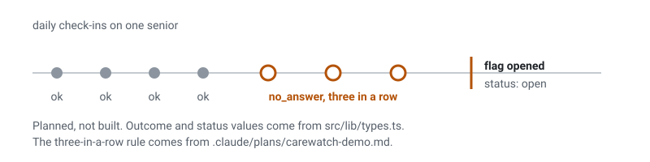

<div align="center">

# CareWatch

A planned check-in system for Active Ageing Centres in Singapore: volunteers log daily wellness checks on seniors living alone, and centre staff follow up on seniors who cannot be reached. Only a scaffold exists so far.

<picture>
  <source media="(prefers-color-scheme: dark)" srcset="docs/how-it-works-dark.svg">
  
</picture>

<sub>Planned rule, not built yet: three missed check-ins in a row open a flag for staff.</sub>

</div>

## Why

Volunteers are each assigned a small group of seniors and check in daily from a phone browser, with no app to install. Staff see who has not been reached. A senior who goes unanswered for three check-ins in a row is flagged for staff to review.

## Status

Built (in `src/`):

- Vite + React + TypeScript app with Tailwind and a PWA manifest (`vite.config.ts`)
- A typed Supabase client (`src/lib/supabase.ts`) and domain types for six tables (`src/lib/types.ts`)

Not built: login, check-in form, staff dashboard, flag logic, XLSX import, database schema and row-level security policies, any backend, Docker, Terraform. Everything below this section describes the plan in `.claude/plans/carewatch-demo.md` and `.claude/project/tech-stack.md`, not working code.

## Running it

You need a Supabase project URL and a client key. Copy `.env.example` to `.env.local` and fill in `VITE_SUPABASE_URL` and `VITE_SUPABASE_ANON_KEY`; the app throws on start if either is missing (`src/lib/supabase.ts`).

```bash
npm install --legacy-peer-deps   # plain `npm install` fails: vite-plugin-pwa@1.2.0 has a peer conflict with vite@8
npm run dev
```

The scaffold makes no Supabase calls yet, so any well-formed URL and key value gets you to the page in the screenshot.

## Planned flow

<picture>
  <source media="(prefers-color-scheme: dark)" srcset="docs/how-it-works-dark.svg">
  
</picture>

The demo plan has the frontend check the last three outcomes after each check-in and create or update a flag; there is no background job in the demo. Check-in outcomes are `ok`, `no_answer` or `flagged`. Flag statuses are `open`, `reviewed`, `actioned` and `escalated`.

## Data model

`src/lib/types.ts` defines these tables: `aacs`, `profiles` (role `volunteer`, `staff` or `admin`), `seniors`, `assignments`, `checkins` and `flags`. Every table except `aacs` carries `aac_id`. `EscalationLevel` (`review`, `urgent`, `emergency`) is defined as a type, but there is no escalation table in `types.ts`.

The plan also lists an escalation cases table and an audit log, which are not in the code. The schema file the types refer to (`supabase/schema.sql`) does not exist in the repo.

## Multi-tenancy

The plan is for every core table to carry `aac_id`, with PostgreSQL row-level security so that a user from one centre cannot read another centre's rows at the database level, not just in the application. Staff and admin roles would be scoped to their centre by the JWT. A super-admin role for the central team would query across centres for reporting. None of the policies are written yet.

## Import

Planned: staff upload an XLSX file, the browser parses it with SheetJS and shows a column-mapping screen, and the confirmed rows go to the database. The demo plan does this as an upsert on a unique `(aac_id, unit_number)` index through Supabase. The production plan instead posts normalised JSON to `POST /aac/:id/seniors/import`, so that other sources (the plan names SocialServiceNet and custom CRMs) could use the same endpoint. `xlsx` is in `package.json`; nothing calls it yet.

## Planned stack

Demo, from the plan: PWA (React + Vite) on Vercel, Supabase for Postgres, auth and row-level security, email OTP login, SheetJS import in the browser, no push notifications.

Production, from the plan:

| Layer | Choice |
|---|---|
| Volunteer interface | PWA (React + Vite); the plan assumes it works on Android 8+ |
| Staff dashboard | React + Vite, separate deployment |
| Backend | Node.js + Fastify |
| Database | PostgreSQL on AWS RDS, ap-southeast-1 |
| Auth | JWT; volunteers by Twilio phone OTP, staff by email and password |
| Push | Firebase Cloud Messaging (Web Push) |
| Background jobs | BullMQ + Redis (ElastiCache): daily reminders, auto-escalation after 3 consecutive no-answers |
| Hosting | ECS Fargate, S3 + CloudFront |
| Infrastructure | Docker, Prisma migrations, Terraform |
| Monitoring | CloudWatch, Sentry |

## Planned API

None of these endpoints exist. They are the production plan; the demo uses Supabase directly.

| Method | Endpoint | Role | Purpose |
|---|---|---|---|
| POST | `/auth/otp/request` | Public | Request OTP to phone |
| POST | `/auth/otp/verify` | Public | Verify OTP, return JWT |
| GET | `/me/seniors` | Volunteer | Assigned seniors only |
| GET | `/seniors/:id` | Volunteer / Staff | Profile (field-filtered by role) |
| POST | `/seniors/:id/checkins` | Volunteer | Submit check-in |
| POST | `/aac/:id/seniors/import` | Staff / Admin | Bulk import from XLSX |
| GET | `/dashboard/overview` | Staff | Stats across all blocks |
| GET | `/dashboard/flags` | Staff | Open flag queue |
| PATCH | `/flags/:id` | Staff | Update flag status |
| POST | `/escalations` | Staff | Open escalation case |
| GET | `/volunteers` | Staff | Volunteer list + activity |
| POST | `/assignments` | Admin | Assign volunteer to senior |
| PATCH | `/seniors/:id/visibility` | Admin | Control what volunteers see |
| PATCH | `/seniors/:id/consent` | Admin | Update consent status |
| GET | `/reports/coverage` | Super Admin | Cross-AAC coverage report |

## Phases

Estimates from the plan, not commitments.

| Phase | Scope | Estimate |
|---|---|---|
| 0 Demo | PWA + Supabase, check-in flow, dashboard, XLSX import, flagging | 2-3 weeks |
| 1 Production MVP | AWS Singapore, multi-centre RLS, Twilio OTP, push, BullMQ jobs, audit log | 6-8 weeks after phase 0 |
| 2 Integration | Adapters for existing systems, cross-centre reporting | 4 weeks after phase 1 is stable |
| 3 Scale and insights | Volunteer fatigue analytics, escalation outcome tracking, SingPass/Corppass | Ongoing |

## Portability

The plan is to containerise services with Docker, keep schema history in Prisma migrations and define AWS infrastructure in Terraform, so another vendor could redeploy it. The repo has none of the three today.
